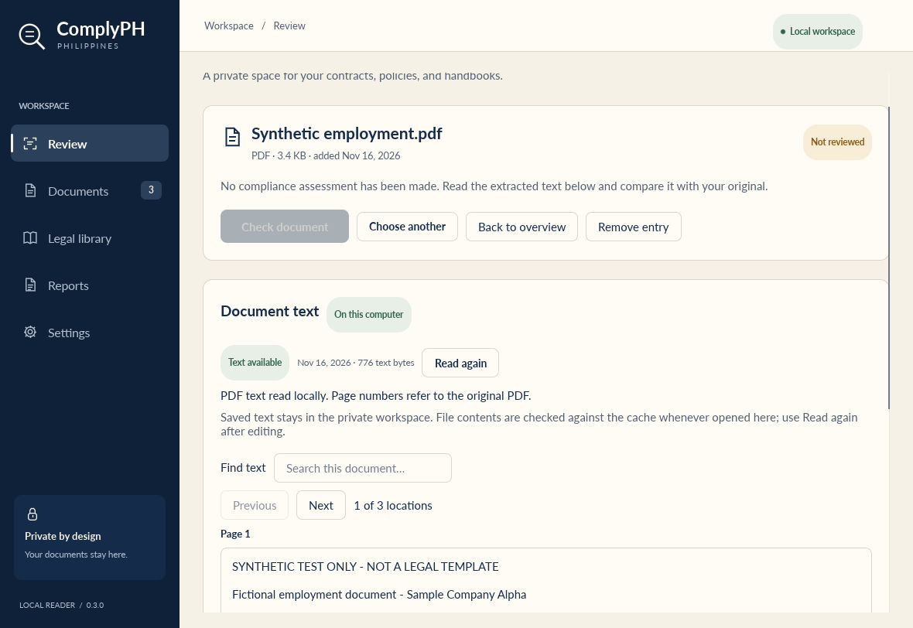
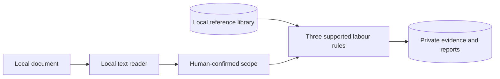

<p align="center">
  
</p>

<p align="center">
  <a href="https://github.com/tatselkrik/complyph/releases/tag/v0.4.0"></a>
  
  
  
  <a href="LICENSE"></a>
  <a href="https://github.com/tatselkrik/complyph/actions/workflows/ci.yml"></a>
</p>

<p align="center">
  <strong>Clarity starts with a document.</strong><br>
  A native Rust workspace for Philippine compliance document review,
  with an official reference library and private documents kept on your computer.
</p>

<p align="center">
  <a href="#current-version">Current version</a> ·
  <a href="#install">Install</a> ·
  <a href="#starter-library">Starter library</a> ·
  <a href="#how-it-works">How it works</a> ·
  <a href="#built-to-scale">Future scope</a> ·
  <a href="#developer-setup">Developer setup</a> ·
  <a href="#documentation">Documentation</a>
</p>



<p align="center"><sub>Actual native application preview · Synthetic workspace and public sources · Navy blue and cream · Captured on Linux</sub></p>

## Current version

**ComplyPH v0.4.0 adds three focused, source-cited labour checks and saved local reviews.** Windows workspace data now lives at **`C:\ProgramData\ComplyPH`**, with safe migration from existing LaborLens PH or ComplyPH data folders.

| Area | Available |
| --- | --- |
| Native desktop | Rust/egui interface in navy blue and cream; no browser or command prompt for normal use |
| Private reader | Local PDF/DOCX extraction, text search, physical PDF pages and Word paragraph/table references; SHA-256 cache validation |
| Focused checks | Normal daily working hours (Article 83), ordinary-day overtime additional premium (Article 87), night shift differential (Article 86) |
| Review context | Human-confirmed applicability, net working time, premium basis, operative statements and reading accuracy |
| Evidence | Matched document passages, source articles, exact decimal comparisons, rule version and document/source hashes |
| Reports | Saved local history with scope, evidence and unresolved results; copy a report as JSON |
| Legal library | 19 preserved references across seven domains, classified by provenance |
| Migration | Automatic copy from a single detected legacy workspace; folder picker for custom/ambiguous locations; originals and old workspace preserved |
| Synthetic samples | Seven reader fixtures plus three focused-check fixtures, all fictional |

The checks evaluate a small set of explicit numeric statements. **A matching term is not a compliance verdict.** Missing context, unsupported wording, conflicting values and incomplete reading remain unresolved. No qualified Philippine lawyer has certified the rules. See the [scope and validation matrix](docs/VALIDATED_CHECKS.md).

Automatic daily source checks, watched folders, in-app OCR, manual legal-source import and checks for the other domains remain planned. The app currently has no HTTP client, cloud AI or document upload feature.

## Install

Download the [v0.4.0 release](https://github.com/tatselkrik/complyph/releases/tag/v0.4.0):

| Download | Use |
| --- | --- |
| [Windows installer](https://github.com/tatselkrik/complyph/releases/download/v0.4.0/ComplyPH-Setup-0.4.0.exe) | Installs for the current user, retains the registered installation location and creates shortcuts |
| [Windows app ZIP](https://github.com/tatselkrik/complyph/releases/download/v0.4.0/ComplyPH-Windows-x64-0.4.0.zip) | Extract and open `ComplyPH.exe` |
| [SHA-256 checksums](https://github.com/tatselkrik/complyph/releases/download/v0.4.0/SHA256SUMS.txt) | Verify download integrity |

1. Close every LaborLens PH / ComplyPH window, then install the update.
2. Open **ComplyPH** from its shortcut. A single detected legacy workspace is copied to ProgramData automatically. The old folder stays as a backup.
3. In **Review**, choose a local document and compare its extracted text with the original.
4. Select **Check document**, establish each rule's scope and run the local review. View saved findings in **Reports**.
5. To try fictional examples, open `Samples/Synthetic labour baseline.pdf`, `Synthetic labour issues.docx` or `Synthetic labour ambiguous.docx` from the installation folder.

Normal use needs no Rust, Python, AI model, API key or subscription. The Windows build is unsigned; Microsoft SmartScreen may show an unrecognized-app prompt. See [verification and platform limits](docs/VERIFICATION.md).

## Starter library

The collection contains **14 verified agency downloads**, **3 identity-checked uploaded copies** and **2 provisional third-party copies**. Preservation hashes are checked for all 19. These classifications do not establish legal currency, amendment completeness or compliance.

| Domain | Included references |
| --- | --- |
| Labor | Senate P.D. 442 compilation; R.A. 11210; uploaded DOLE 2022 Labor Code edition |
| DOLE OSHS | R.A. 11058; shared Labor Code reference; uploaded 2017 OSHS compilation and D.O. 252-25 |
| Privacy / NPC | R.A. 10173; NPC IRR; NPC Circular 2023-06 |
| BIR / Tax | TRAIN; RR 29-2025; dated external citation to PwC's January 2020 tax compilation |
| SSS | R.A. 11199; SSS Circular 2024-006 |
| PhilHealth | R.A. 11223; advisories 2025-0002 and 2026-0050 |
| Pag-IBIG | R.A. 9679; provisional Circular 460 mirror and Circular 499 stitched Facebook images |

The uploaded DOLE documents were checked for identity/content structure; inaccessible agency URLs prevented exact agency-byte comparison. D.O. 252-25 and Circular 499 use OCR-derived reading text. The OSHS preparation split was checked against all 431 original pages; the app preserves the original PDF and derived reading text. OCR figures and matrices require comparison with page images.

The PwC PDF is dated secondary material, ends at 31 January 2020 and is **not redistributed** in this public repository or release. It does not close the current NIRC coverage gap. Circular 499 remains provisional despite corroborating government references. See the [source inventory](library/README.md), [new-source assessment](library/ADDITIONS.md) and [provenance manifest](library/starter/manifest.json).

## How it works

A bounded child process reads document bytes locally. It never follows document links or runs macros, fields or PDF JavaScript. Extracted text and hashes are cached privately; originals stay in their existing locations. PDF reading is limited to 32 MiB input, 300 pages and 4 MiB text, with a 20-second worker timeout. Image-only PDFs need external OCR; mixed/unreadable pages prevent a numeric threshold conclusion. Word text boxes, images and some revisions are omitted, so compare the original.

The three rules use a pinned agency reference whose original and derived-text hashes must match. They recognize deliberately narrow explicit statements; they do not infer eligibility, calculate payroll, assess other laws, or decide whether a new legal issuance supersedes a rule. The review stores the human-confirmed context and its evidence locally.



The independent updater currently reports public-catalog status only. Daily approved-source downloads and operating-system enforcement of its separation from private data remain future work. A new legal text will require rule review before supported checks can use it.

## Built to scale

The source catalog supports Labor, DOLE OSHS, Privacy/NPC, BIR, SSS, PhilHealth and Pag-IBIG. Only the three stated labour checks are implemented. Future domain packs need their own applicability conditions, versioned sources, evidence requirements and independent validation cases. See [domain design](docs/COMPLIANCE_DOMAINS.md) and [roadmap](docs/ROADMAP.md).

## Local storage and privacy

On Windows, `%ProgramData%\ComplyPH` normally resolves to:

```text
C:\ProgramData\ComplyPH\private\workspace.sqlite3
C:\ProgramData\ComplyPH\library\catalog.sqlite3
```

The folder has restricted Windows permissions for its owning account, SYSTEM and Administrators. It is a fixed machine path, **not a shared multi-user document store**. The app refuses to take ownership of another account's workspace. SQLite is not encrypted by the app.

On first use, a single existing `%LOCALAPPDATA%\LaborLens PH`, `%LOCALAPPDATA%\ComplyPH` or known equivalent under `C:\Users\Public` is copied using SQLite's backup API, checked and activated atomically. The original workspace stays intact; cached text, references and preferences are retained. Ambiguous roots stop for a folder selection. **Settings → Import an existing workspace** handles custom locations and refuses to replace a destination with documents/reports. An unused destination is retained as a separate backup during explicit import. No manual folder move or command prompt is required.

Private schema 3 adds review history; public schema 2 retains source versions. Linux retains its prior local data discovery. Removing a document entry deletes its cache and reports, preserving the original file. Uninstall preserves both the active workspace and old backups. Other backup/sync software operates independently. Read [PRIVACY.md](PRIVACY.md).

## Developer setup

The application and UI are Rust. SQLite is bundled; fonts/icons are local. Development-only fixture generation uses Python, which the installed app does not require.

```text
crates/desktop/   Native UI, bounded reader process and review workflow
crates/core/      Private references, text cache, review history and migrations
crates/extract/   Memory-only PDF/DOCX parsing
crates/checks/    Deterministic rules, scope gates and source pins; no I/O
crates/library/   Public snapshots, provenance, domains and integrity
crates/paths/     Data-root discovery and owner-only permissions
crates/updater/   Separate public-catalog status tool
library/starter/  Preserved source copies, reading text and manifest
examples/         Fictional reader/check fixtures and expected outcomes
```

Use the pinned toolchain in `rust-toolchain.toml`. Windows development uses Rust/MSVC and Microsoft C++ build tools.

```powershell
cargo run --locked
cargo test --workspace --locked
cargo clippy --workspace --all-targets --locked -- -D warnings
cargo fmt --all --check
cargo build --workspace --release --locked
.\scripts\package-windows.ps1
```

Normal use never needs these commands. Developer diagnostics accept `--data-dir PATH` for isolated storage, `--read-file PATH --output NEW-JSON-FILE`, or `--check-file PATH --context CONTEXT-JSON --output NEW-JSON-FILE` (each diagnostic also accepts `--data-dir`). Existing output files are never overwritten. `complyph-updater --status` reports public library state and refuses to migrate private data.

## Documentation

- [Architecture](docs/ARCHITECTURE.md)
- [Supported checks and validation](docs/VALIDATED_CHECKS.md)
- [Library inventory](library/README.md) and [new additions](library/ADDITIONS.md)
- [Verification](docs/VERIFICATION.md)
- [Privacy](PRIVACY.md)
- [Roadmap](docs/ROADMAP.md)
- [Release notes](docs/releases/v0.4.0.md)

## License

Application source is MIT licensed; fonts use SIL OFL. Legal publications retain their respective publication terms. No government endorsement is implied. See [LICENSE](LICENSE) and bundled third-party notices.
