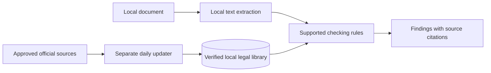

<p align="center">
  
</p>

<p align="center">
  <a href="https://github.com/tatselkrik/complyph/releases/tag/v0.3.0"></a>
  
  
  
  <a href="LICENSE"></a>
  <a href="https://github.com/tatselkrik/complyph/actions/workflows/ci.yml"></a>
</p>

<p align="center">
  <strong>Clarity starts with a document.</strong><br>
  A native Rust workspace for Philippine compliance document review,
  with an official reference library and private documents kept on your computer.
</p>

<p align="center">
  <a href="#current-version">Current version</a> ·
  <a href="#install">Install</a> ·
  <a href="#starter-library">Starter library</a> ·
  <a href="#how-it-works">How it works</a> ·
  <a href="#built-to-scale">Future scope</a> ·
  <a href="#developer-setup">Developer setup</a> ·
  <a href="#documentation">Documentation</a>
</p>


<p align="center"><sub>Actual native application preview · Synthetic workspace and public sources · Navy blue and cream · Captured on Linux</sub></p>

## Current version

**ComplyPH v0.3.0 reads supported PDF and DOCX text locally.** It adds a private document reader, content-aware caching, and seven synthetic test cases, while retaining existing document entries, preferences, and the reference library.

The bundled library contains **14 official-publication snapshots across seven domains**. **Legal checking, OCR, reports, watched folders, daily source checks, and manual source import are not implemented yet.** Reading text does not establish compliance.

| Area | Available in v0.3.0 |
| --- | --- |
| **Desktop workspace** | Native Rust interface with Review, Documents, Legal library, Reports, and Settings sections |
| **Document intake** | Select PDF/DOCX files through the in-app Rust file browser or drop files into the window |
| **Document list** | Search filenames, view file metadata and locations, and avoid duplicate entries for the same canonical path |
| **Document reader** | Selectable text, location navigation, search, read again, and cancellation; PDF page numbers and Word paragraph/table/part references |
| **Private text cache** | Extracted text, source hashes, and read dates in local SQLite; file contents checked against the cache when opened |
| **Reading states** | Clear results for scanned/image-only, password-protected, damaged, and over-limit files |
| **Synthetic samples** | Seven fictional cases with expected results; PDF/Word/Scan buttons for trying the app |
| **Local persistence** | Document references, text cache, preferences, last workspace section, and full-path visibility |
| **Original files** | Register references without copying or changing the originals; remove an entry without deleting its file |
| **Source separation** | Separate private workspace and public legal-source catalog crates and databases |
| **Official references** | 14 preserved source snapshots, with original bytes, reading text, source URLs, dates, and SHA-256 hashes |
| **Library reader** | Seven domain filters, title/instrument/issuer search, offline reading, and search within a source |
| **Source export** | Save exact publication originals without overwriting existing files |

## Starter library

The collection was checked on **16 November 2026 UTC**.

| Domain | Included references |
| --- | --- |
| Labor | Senate reference compilation of P.D. 442; R.A. 11210 |
| DOLE OSHS | R.A. 11058; relevant portions of the shared Labor Code reference |
| Privacy / NPC | R.A. 10173; NPC-published IRR; NPC Circular 2023-06 |
| BIR / Tax | R.A. 10963 (TRAIN); BIR RR 29-2025 |
| SSS | R.A. 11199; SSS Circular 2024-006 |
| PhilHealth | R.A. 11223; advisories 2025-0002 and 2026-0050 |
| Pag-IBIG | R.A. 9679 |

The Labor Code reference belongs to two domains; there are **14 distinct sources**.

**Verified means official publication origin, document identity, and preserved-content integrity.** It does not establish amendment completeness, current applicability, or compliance. Reading text can contain OCR errors; use the saved original for exact wording and figures.

Known gaps include the DOLE 2022 Labor Code edition, D.O. 252-25 and the full OSHS technical standards, Pag-IBIG Circular 460 and later remittance issuances, and a complete NIRC amendment collection. Blocked downloads are not counted as verified. The PhilHealth 2025 premium advisory remains a dated 2025 reference.

See the [source inventory and verification scope](library/README.md) and [full provenance manifest](library/starter/manifest.json).

## Install

Download the Windows x64 build from the [v0.3.0 release](https://github.com/tatselkrik/complyph/releases/tag/v0.3.0):

| Download | Use |
| --- | --- |
| [Windows installer](https://github.com/tatselkrik/complyph/releases/download/v0.3.0/ComplyPH-Setup-0.3.0.exe) | Installs for the current user, upgrades the registered LaborLens PH installation, and creates ComplyPH shortcuts |
| [Windows app ZIP](https://github.com/tatselkrik/complyph/releases/download/v0.3.0/ComplyPH-Windows-x64-0.3.0.zip) | Extract the folder and open `ComplyPH.exe` directly |
| [SHA-256 checksums](https://github.com/tatselkrik/complyph/releases/download/v0.3.0/SHA256SUMS.txt) | Verify the release downloads |

1. Close LaborLens PH or ComplyPH if it is running.
2. Run the installer, or extract the app ZIP. Keep the detected installation location when upgrading from LaborLens PH.
3. Open **ComplyPH** from its shortcut or executable.
4. Use **Review → Try a synthetic sample: PDF / Word / Scan**, or choose your own local document. **Samples** includes all seven reader cases and their expected outcomes. Open **Legal library** to browse the bundled sources.

Normal use requires no command prompt, Rust installation, Python, browser session, AI model, or API key. This development release is unsigned. See the [verification notes](docs/VERIFICATION.md) for the platform checks and their limits.

## How it works

Selecting a file registers its location and starts a local reading job. A separate process of the same Rust executable reads document bytes through local pipes; no shell command, AI, or remote service is involved. Extracted text, original-location references, a SHA-256 content hash, and the read date are saved in the private workspace. The original stays unchanged in its existing location.

PDF locations retain physical page numbers. Word locations identify XML parts, paragraphs, and table cells; they do not infer Word page numbers. Text order, unusual fonts, images, text boxes, and revision history can affect coverage. Scanned PDFs show **Needs OCR**, and mixed PDFs flag unread pages. Compare extracted text with the original.

The reader accepts files up to 32 MiB, PDFs up to 300 pages, and up to 4 MiB of text. Parsing has memory/CPU limits and a 20-second timeout. These are resource limits, not an operating-system security sandbox. See the [reader design and limitations](docs/ARCHITECTURE.md#private-document-reading).

The intended review workflow is:



Local text extraction and the reference library are implemented. The diagram’s checking, report, and daily-updater components remain planned.

The future updater will check approved legal sources daily and automatically preserve new source versions locally. A new legal text does not automatically create a correct checking rule: unsupported legal changes will need rule maintenance and a visible review status. See the [roadmap](docs/ROADMAP.md).

## Built to scale

Labor compliance is the first planned review area. The architecture is intended to support additional Philippine compliance domains: **DOLE Occupational Safety and Health Standards (OSHS), the Data Privacy Act and NPC issuances, BIR requirements, SSS, PhilHealth, and Pag-IBIG**.

One shared local review engine will handle document extraction, review context, findings, and citations. Each domain will supply its own approved sources, applicability conditions, versioned rules, required evidence, and validation cases. A document can be reviewed against several selected domains, with coverage and missing information reported for each.

Some checks will need local payroll data or supporting records alongside the document. The source/domain catalog is implemented; the checking engine and domain-specific rules remain planned. See the [compliance-domain design](docs/COMPLIANCE_DOMAINS.md).

## Local storage and privacy

- Document text, file references, content hashes, and reading dates stay in the private local workspace. The separate public catalog stores the bundled legal texts. There are no review results yet.
- The desktop and current updater status stub contain no HTTP client or AI integration.
- The updater crate has no dependency on the private document-workspace crate. A future downloader still needs enforced operating-system access restrictions before it is enabled.
- There are no accounts, advertising, analytics, document uploads, or paid AI services in this foundation.

Fresh Windows installations store workspace data under:

```text
%LOCALAPPDATA%\ComplyPH\private\workspace.sqlite3
%LOCALAPPDATA%\ComplyPH\library\catalog.sqlite3
```

An existing `%LOCALAPPDATA%\LaborLens PH` data directory is reused in place. ComplyPH does not move live databases or create a second workspace. If both branded data roots exist, it stops for explicit selection using `--data-dir`. The private schema migrates from version 1 to 2 for text caches, preserving document entries and preferences. The public catalog remains at version 2, retaining prior sources and versions.

Removing a workspace entry also removes its cached text; the original is preserved. Uninstalling preserves application data and original documents. Moving an original can make its saved reference unavailable; select it again from the new location. Use a local document location appropriate for your privacy requirements; other backup or synchronization software operates independently of this app. Read the [privacy notes](PRIVACY.md).

## Developer setup

The application interface and logic are written in Rust using egui/eframe. PDF reading uses pdf-extract/lopdf; DOCX reading uses zip/quick-xml. SQLite is bundled through rusqlite. Fonts and icons are packaged locally. The pinned file-browser dependency includes a documented correction for light-theme editor backgrounds.

```text
ComplyPH/
├── crates/desktop/       Native interface and document interactions
├── crates/core/          Private workspace, text cache, preferences, and migrations
├── crates/extract/       Memory-only PDF and DOCX text readers
├── crates/library/       Public sources, domains, snapshots, integrity, and migration
├── crates/paths/         Current/legacy data-root discovery
├── library/starter/      Official originals, reading text, and provenance
├── crates/updater/       Independent public-catalog status entry point
├── assets/               Fonts, licenses, and application icons
├── examples/             Synthetic reader cases and expected results
├── packaging/windows/    Installer and dependency notices
├── scripts/              Windows packaging and isolated CI checks
├── vendor/               Pinned Rust file-browser patch
└── docs/                 Architecture, design, roadmap, and verification
```

Use the toolchain in `rust-toolchain.toml`. Windows development requires Rust/MSVC and the standard Microsoft C++ build tools.

```powershell
cargo run --locked
cargo test --workspace --locked
cargo clippy --workspace --all-targets --locked -- -D warnings
cargo fmt --all --check
cargo build --workspace --release --locked
```

The desktop output is `target/release/complyph.exe`. Developers can use `--data-dir PATH` for an isolated workspace. Windows/MSVC builds link the C runtime statically.

For installer packaging, install the free NSIS 3 tools and run:

```powershell
.\scripts\package-windows.ps1
```

The independent updater currently reports catalog status only:

```powershell
cargo run -p complyph-updater -- --status --library-dir PATH
```

It performs no downloads and reports that automatic updates are unavailable.

## Verification

Rust tests cover real executable/worker reading, all seven synthetic cases, Unicode and document locations, malformed XML/entity rejection, reading limits, cache invalidation, cancellation/timeout handling, private schema migration, original preservation, and the existing source-library and data-root checks. Formatting and Clippy run with warnings denied.

GitHub Actions builds and packages Windows downloads and checks the installed reader, fresh installation, upgrades from v0.1.0 and v0.2.0, shortcuts, private schema migration, legacy data discovery, and data preservation through uninstall. This is separate from interactive verification of the native interface and target-PC display scaling. See the [verification scope](docs/VERIFICATION.md).

## Documentation

| Documentation | Reference |
| --- | --- |
| Source inventory, provenance, and acquisition gaps | [Starter library](library/README.md) |
| Components, privacy boundary, and update design | [Architecture](docs/ARCHITECTURE.md) |
| Shared review engine and future regulatory domains | [Compliance domains](docs/COMPLIANCE_DOMAINS.md) |
| Navy-and-cream interface and interaction guidance | [Interface design](docs/DESIGN.md) |
| Verified sources, rules, extraction, and future milestones | [Roadmap](docs/ROADMAP.md) |
| Test scope and platform limits | [Verification](docs/VERIFICATION.md) |
| Current release details | [v0.3.0 notes](docs/releases/v0.3.0.md) |
| Local records and deletion behavior | [Privacy](PRIVACY.md) |
| File-browser patch and upstream attribution | [Dependency patch](vendor/egui-file-dialog/LABORLENS-PATCH.md) |

## License

ComplyPH is MIT-licensed. Lato fonts use the SIL Open Font License. Bundled dependency and toolchain notices accompany the Windows downloads. See [LICENSE](LICENSE) and [third-party notices](packaging/windows/THIRD_PARTY_NOTICES.txt).

<p align="center"><sub>ComplyPH · Local documents, traceable sources · Built with Rust</sub></p>
