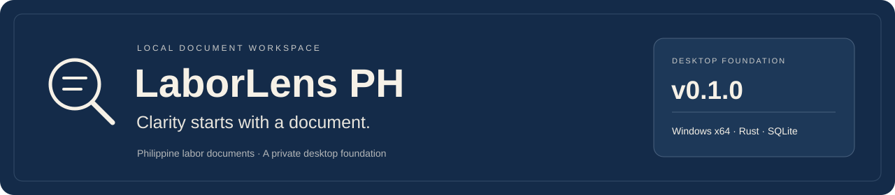
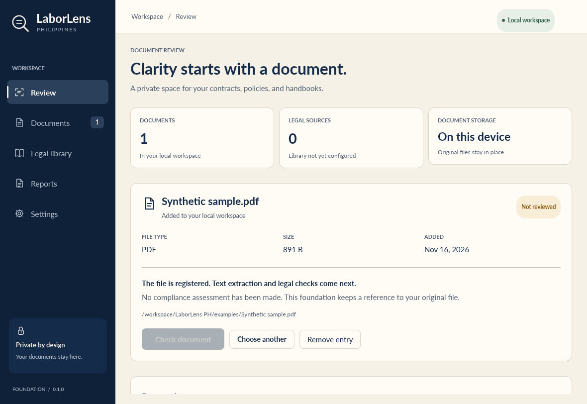
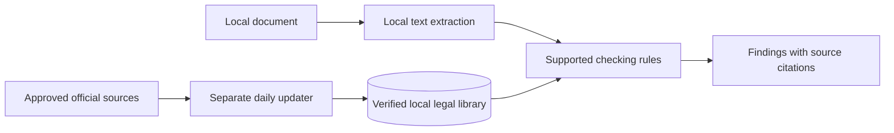

<p align="center">
  
</p>

<p align="center">
  <a href="https://github.com/tatselkrik/laborlens-ph/releases/tag/v0.1.0"></a>
  
  
  
  <a href="LICENSE"></a>
  <a href="https://github.com/tatselkrik/laborlens-ph/actions/workflows/ci.yml"></a>
</p>

<p align="center">
  <strong>Clarity starts with a document.</strong><br>
  A native Rust desktop project for reviewing HR documents against Philippine labor law,
  with documents and the planned legal library kept on your computer.
</p>

<p align="center">
  <a href="#current-version">Current version</a> ·
  <a href="#install">Install</a> ·
  <a href="#how-it-works">How it works</a> ·
  <a href="#developer-setup">Developer setup</a> ·
  <a href="#documentation">Documentation</a>
</p>



<p align="center"><sub>Actual native application preview · Synthetic sample document · Navy blue and cream · Captured on Linux</sub></p>

## Current version

**v0.1.0 is the desktop foundation.** You can select local documents, keep a searchable document list, inspect file details, and save workspace preferences.

The verified legal library, text extraction, legal checking, and source-update service are **not implemented yet**. The application labels these features accordingly and does not produce a compliance assessment.

| Area | Available in v0.1.0 |
| --- | --- |
| **Desktop workspace** | Native Rust interface with Review, Documents, Legal library, Reports, and Settings sections |
| **Document intake** | Select PDF/DOCX files through the in-app Rust file browser or drop files into the window |
| **Document list** | Search filenames, view file metadata and locations, and avoid duplicate entries for the same canonical path |
| **Local persistence** | SQLite document references and preferences, including the last workspace section and full-path visibility |
| **Original files** | Register references without copying or changing the originals; remove an entry without deleting its file |
| **Source separation** | Separate private workspace and public legal-source catalog crates and databases |

## Install

Download the Windows x64 build from the [v0.1.0 release](https://github.com/tatselkrik/laborlens-ph/releases/tag/v0.1.0):

| Download | Use |
| --- | --- |
| [Windows installer](https://github.com/tatselkrik/laborlens-ph/releases/download/v0.1.0/LaborLensPH-Setup-0.1.0.exe) | Installs for the current user and creates desktop and Start menu shortcuts |
| [Windows app ZIP](https://github.com/tatselkrik/laborlens-ph/releases/download/v0.1.0/LaborLensPH-Windows-x64-0.1.0.zip) | Extract the folder and open `LaborLensPH.exe` directly |
| [SHA-256 checksums](https://github.com/tatselkrik/laborlens-ph/releases/download/v0.1.0/SHA256SUMS.txt) | Verify the release downloads |

1. Close LaborLens PH if it is already running.
2. Run the installer, or extract the app ZIP.
3. Open **LaborLens PH** from its shortcut or executable.
4. Choose a document. The bundled **Samples** folder contains a synthetic PDF and DOCX for trying the workspace.

Normal use requires no command prompt, Rust installation, Python, browser session, AI model, or API key. This development release is unsigned. See the [verification notes](docs/VERIFICATION.md) for the platform checks and their limits.

## How it works

Selecting a file stores its name, canonical path, size, and modification time in a local SQLite workspace. **The foundation does not read the document text.** The original stays in its existing location.

The intended review workflow is:



The diagram describes the planned checking and update components. The current release provides the desktop workspace and storage foundation.

The future updater will check approved legal sources daily and automatically preserve new source versions locally. A new legal text does not automatically create a correct checking rule: unsupported legal changes will need rule maintenance and a visible review status. See the [roadmap](docs/ROADMAP.md).

## Local storage and privacy

- Documents, extracted text, and review results are intended to stay on the computer. v0.1.0 stores file references and metadata only.
- The desktop and current updater status stub contain no HTTP client or AI integration.
- The updater crate has no dependency on the private document-workspace crate. A future downloader still needs enforced operating-system access restrictions before it is enabled.
- There are no accounts, advertising, analytics, document uploads, or paid AI services in this foundation.

Windows workspace data is stored under:

```text
%LOCALAPPDATA%\LaborLens PH\private\workspace.sqlite3
%LOCALAPPDATA%\LaborLens PH\library\catalog.sqlite3
```

Uninstalling preserves application data and original documents. Moving an original can make its saved reference unavailable; select it again from the new location. Use a local document location appropriate for your privacy requirements; other backup or synchronization software operates independently of this app. Read the [privacy notes](PRIVACY.md).

## Developer setup

The application interface and logic are written in Rust using egui/eframe. SQLite is bundled through rusqlite. Fonts and icons are packaged locally. The pinned file-browser dependency includes a documented correction for light-theme editor backgrounds.

```text
laborlens-ph/
├── crates/desktop/       Native interface and document interactions
├── crates/core/          Private workspace, preferences, and migrations
├── crates/library/       Public source catalog and source-version schema
├── crates/updater/       Independent public-catalog status entry point
├── assets/               Fonts, licenses, and application icons
├── examples/             Synthetic PDF and DOCX samples
├── packaging/windows/    Installer and dependency notices
├── scripts/              Windows packaging and isolated CI checks
├── vendor/               Pinned Rust file-browser patch
└── docs/                 Architecture, design, roadmap, and verification
```

Use the toolchain in `rust-toolchain.toml`. Windows development requires Rust/MSVC and the standard Microsoft C++ build tools.

```powershell
cargo run --locked
cargo test --workspace --locked
cargo clippy --workspace --all-targets --locked -- -D warnings
cargo fmt --all --check
cargo build --workspace --release --locked
```

The desktop output is `target/release/laborlens-ph.exe`. Developers can use `--data-dir PATH` for an isolated workspace. Windows/MSVC builds link the C runtime statically.

For installer packaging, install the free NSIS 3 tools and run:

```powershell
.\scripts\package-windows.ps1
```

The independent updater currently reports catalog status only:

```powershell
cargo run -p laborlens-updater -- --status --library-dir PATH
```

It performs no downloads and reports that automatic updates are unavailable.

## Verification

Eight storage tests cover persistence, duplicate paths, invalid selections, original-file preservation, schema-version protection, malformed settings, an empty source catalog, and separation from private workspace files. Formatting and Clippy are checked with warnings denied.

GitHub Actions builds on Windows, packages the installer and app ZIP, and tests silent installation, executable startup through `--help`, shortcuts, and uninstall preservation in an isolated runner profile. This is separate from interactive verification of the native interface and target-PC display scaling. See the [verification scope](docs/VERIFICATION.md).

## Documentation

| Documentation | Reference |
| --- | --- |
| Components, privacy boundary, and update design | [Architecture](docs/ARCHITECTURE.md) |
| Navy-and-cream interface and interaction guidance | [Interface design](docs/DESIGN.md) |
| Verified sources, rules, extraction, and future milestones | [Roadmap](docs/ROADMAP.md) |
| Test scope and platform limits | [Verification](docs/VERIFICATION.md) |
| Local records and deletion behavior | [Privacy](PRIVACY.md) |
| File-browser patch and upstream attribution | [Dependency patch](vendor/egui-file-dialog/LABORLENS-PATCH.md) |

## License

LaborLens PH is MIT-licensed. Lato fonts use the SIL Open Font License. Bundled dependency and toolchain notices accompany the Windows downloads. See [LICENSE](LICENSE) and [third-party notices](packaging/windows/THIRD_PARTY_NOTICES.txt).

<p align="center"><sub>LaborLens PH · Local documents, traceable sources · Built with Rust</sub></p>
