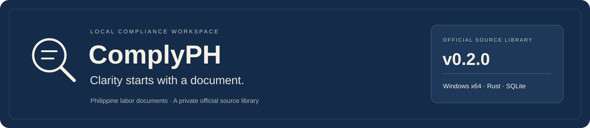
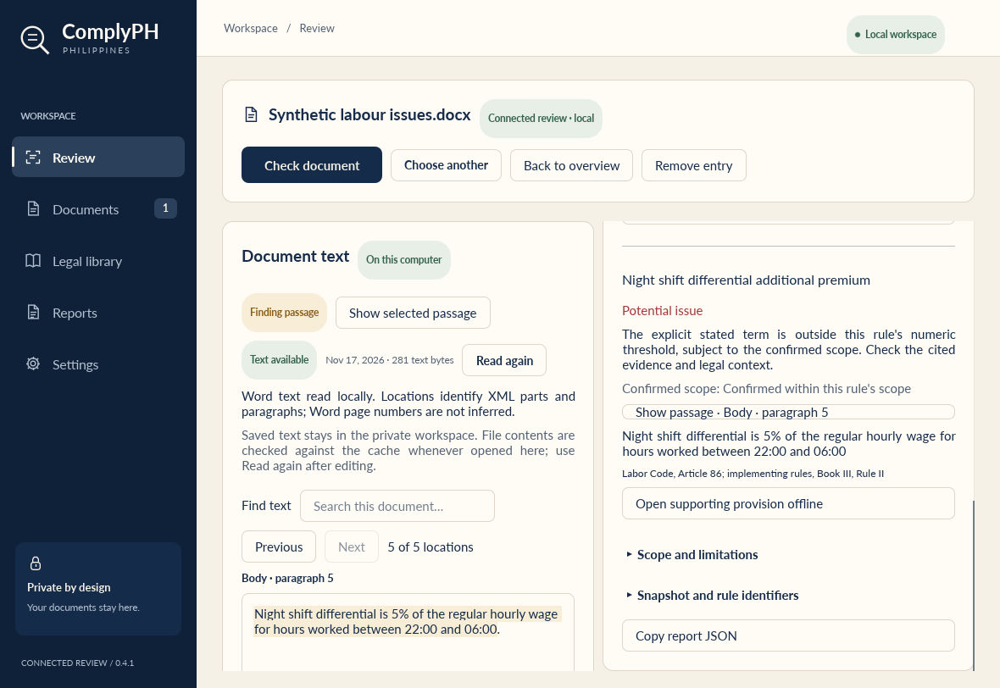

<p align="center">
  
</p>

<p align="center">
  <a href="https://github.com/tatselkrik/complyph/releases/tag/v0.13.0"></a>
  
  
  <a href="LICENSE"></a>
  <a href="https://github.com/tatselkrik/complyph/actions/workflows/ci.yml"></a>
</p>

<p align="center"><strong>Philippine compliance review, on your computer.</strong><br>
Inspect document text beside findings, follow evidence to its original location, and read the supporting legal provision offline.</p>



<p align="center"><sub>Native application preview using fictional test data.</sub></p>

## About

**ComplyPH** is a free, open-source Rust desktop application for reviewing Philippine workplace documents against a local reference library. It reads PDF and DOCX files locally and provides 20 focused checks across seven compliance domains with visible applicability, evidence and source citations. No AI model, account, API key or subscription is required.

The library spans Labor, DOLE OSHS, Privacy/NPC, BIR, SSS, PhilHealth and Pag-IBIG. The [initial twenty-check set](docs/INITIAL_CHECKS.md) covers seven labour terms, OSH seminar hours and PPE charges, breach-notification timing, an annual taxable-compensation band, and stated contribution rates/base limits. Each comparison requires the relevant confirmed facts and evidence. New profiles require an explicit review-period date and recorded applicability basis, with supported periods through CY2026. This is initial coverage; full-domain and payroll/remittance assessments remain future work.

## Features

- **Checks across seven domains:** a finite initial set with explicit coverage/exception/period/basis gates and exact offline legal provisions.
- **Service incentive leave:** confirm employee coverage, qualifying service and exceptions; record the basis, inspect the annual paid entitlement and open Article 95 / Book III Rule V offline.

- **Connected review:** independently scrolling document and findings panes; click a finding to jump to and highlight its PDF page or Word paragraph/table passage.
- **Offline legal provisions:** open the complete supporting article, related provisions or full preserved source from the exact version used by a saved review.
- **Local OCR:** recognize scanned PDF pages with bundled English OCR, page references, low-confidence flags and a separate accuracy confirmation before numeric checking.
- **Watched folder:** opt into local PDF/DOCX intake with a quiet interval, completion/lock checks, duplicate detection and pause/resume controls.
- **Private document reader:** local extraction, text search, location navigation and content-hash-validated caching. Original files remain in place.
- **Document versions:** explicitly link revisions, retain complete extracted readings, compare text changes and reopen each version’s own reviews and follow-up history.
- **Finding comparison:** compare selected reviews with visible scope/source/method differences; corrected numeric results never inherit earlier resolved statuses. Export comparison PDF or full JSON locally.
- **Saved reports:** retain the confirmed scope, matched passages, outcomes, rule versions and document/source hashes; reopen a report beside its document.
- **Reviewer notes and tracking:** add document-review and finding notes; track Unresolved, Acknowledged and Resolved follow-up with append-only local history. Original automated findings stay intact.
- **Offline PDF export:** save findings, evidence, exact legal quotes, scope, identifiers and complete reviewer history in a readable report with embedded fonts. No printer or browser is required.
- **Source update checks:** approve official URLs for daily checks while the app is open, or check now. Windows and supported Linux builds confine the network worker; unavailable protection keeps checks offline.
- **Reviewed library maintenance:** edit version-bound metadata and identity decisions, compare references side by side, adopt or restore a reviewed version, and retain every earlier snapshot.
- **Rule revalidation:** hold affected checks after source changes, preserve legal-change assessments and bind revalidated findings to exact adopted sources.
- **Official publication discovery:** inventory issuance links from approved agency pages, distinguish initial inventory from later links, and route references into manual intake or rule-impact assessment.
- **Add legal source:** import local PDF/DOCX references with an official URL, issuing agency, compliance domains, issue/effective dates and verification notes. Retain original bytes and earlier versions.
- **Traceable reference library:** 19 preserved references across seven domains, with source URLs, dates, integrity hashes, provenance labels and visible coverage gaps.
- **Safe workspace storage:** Windows data at `C:\ProgramData\ComplyPH`, automatic migration from detected earlier workspaces and a folder picker for custom locations.
- **Native interface:** navy blue and cream, with locally bundled fonts and no browser required for ordinary use.

## Install

Download the [latest Windows release](https://github.com/tatselkrik/complyph/releases/latest).

| Package | Instructions |
| --- | --- |
| [Installer](https://github.com/tatselkrik/complyph/releases/download/v0.13.0/ComplyPH-Setup-0.13.0.exe) | Close ComplyPH, run the installer, then open the desktop or Start menu shortcut. |
| [Portable ZIP](https://github.com/tatselkrik/complyph/releases/download/v0.13.0/ComplyPH-Windows-x64-0.13.0.zip) | Extract the complete folder and open `ComplyPH.exe`. |
| [Checksums](https://github.com/tatselkrik/complyph/releases/download/v0.13.0/SHA256SUMS.txt) | Compare the package's SHA-256 hash with the published checksum. |

Normal use requires no command prompt or development tools. The current Windows binaries are unsigned and may trigger Microsoft SmartScreen. Updating or uninstalling preserves workspace data and original documents.

## Review a document

1. Choose **Review → Choose document**, or drag a local PDF/DOCX into the app. The packaged **Samples** folder contains fictional examples.
2. Compare the extracted text with the original, then select **Check document** and establish each rule's applicability.
3. Run the local review. Click a finding title or **Show passage** to navigate to its highlighted evidence.
4. Select **Open supporting provision offline** to inspect the complete cited article and related provisions.
5. Expand **Document review notes** or a finding’s **Reviewer notes and status**. Enter a reviewer name, note/reason and optional follow-up status, then **Save reviewer update**. Earlier entries remain visible.
6. Select **Export PDF…** and choose a new local filename, or **Copy full report JSON**. Save pending notes first.
7. Use **Reports → Open connected review** to return to a saved assessment. If the original has changed, passage navigation is disabled until a new review is made.

A resolved follow-up status records a human decision and never changes the automated result or certifies compliance. Reviewer names are self-reported. Each saved review has separate tracking; a new review starts fresh. PDF exports contain private excerpts and notes, include all saved actions, and do not recheck current documents or laws. See [reports and tracking](docs/REPORTS.md).

A matching numeric term is not a complete compliance verdict. Unclear applicability, unsupported wording, conflicting values and incomplete extraction remain unresolved. See [supported checks and validation](docs/VALIDATED_CHECKS.md).

## Compare revised documents

Open a document or saved report, then choose **Version history / compare…**. Select **Add revised document…**, or explicitly link an existing standalone entry. Reading a changed file at the same path also retains a new version.

Choose earlier and revised readings, select their saved reviews, and **Compare selected versions**. Inspect highlighted text changes, both outcomes and their separate follow-up statuses. **Use earlier scope for a fresh review…** copies scope as a starting point and requires new accuracy confirmations; it copies no notes or statuses. Export the captured comparison as PDF or full JSON.

Retained text remains available after originals move or change. Older reviews without a retained reading show that limitation; missing historical text is never reconstructed from a changed original. Comparison covers extracted text and selected assessments, including their method/source/scope differences. See [reports and document versions](docs/REPORTS.md).

## Scanned documents and folder intake

Choose **Run local OCR** in Review to recognize PDF pages entirely on your computer. Inspect page text and uncertainty highlights, compare every number with the original, and confirm OCR accuracy separately before running checks. The installer includes the runtime; no OCR account or setup command is needed.

Use **Settings → Watched document folder** to select a local intake folder. Completed PDF/DOCX files appear in Documents after a stability interval; unchanged/duplicate files are skipped. Polling runs while the app is open and never starts OCR or reviews automatically. See [OCR, folder controls and limits](docs/OCR_AND_FOLDERS.md).

## Reference library

| Domain | Reference coverage |
| --- | --- |
| Labor | P.D. 442 reference compilation, DOLE 2022 edition, R.A. 11210 |
| DOLE OSHS | R.A. 11058, OSHS compilation through 2017, D.O. 252-25 |
| Privacy / NPC | R.A. 10173, implementing rules, NPC Circular 2023-06 |
| BIR / Tax | TRAIN, RR 29-2025, dated external citation to a January 2020 tax compilation |
| SSS | R.A. 11199, Circular 2024-006 |
| PhilHealth | R.A. 11223, advisories 2025-0002 and 2026-0050 |
| Pag-IBIG | R.A. 9679, provisional copies of Circulars 460 and 499 |

The collection contains **14 verified agency downloads, 3 identity-checked imported copies and 2 provisional third-party copies**. Preserved-byte and reading-text integrity is checked for all 19. Verification does not certify amendment completeness, present applicability or OCR accuracy. The dated PwC tax compilation is an external citation; its PDF is not redistributed.

### Add a legal source

1. Open **Legal library → Add legal source** and choose a local PDF or DOCX reference.
2. Enter its title, instrument/number, issuing agency and official HTTPS URL. Choose one or more compliance domains.
3. Record issue/effective dates as `YYYY-MM-DD`, or leave them blank when unknown. Add effectivity, scope and verification notes as needed.
4. Keep **Awaiting verification**, or choose **Identity checked by me** after comparing the copy with the official publication and recording your comparison.
5. Select **Save legal source**, then find it in the library and **Read local snapshot**. The source URL is a saved citation; importing makes no online request.

Manual imports are stored in `library/catalog.sqlite3`, alongside the starter collection and separately from private reviews. Identical files under the same URL keep their original metadata; changed files under that URL create new snapshots and preserve earlier versions. Bundled references cannot be replaced through manual intake. Scans need external OCR before import; the existing reader limits apply.

A user-recorded identity check is distinct from a verified agency download. Importing a reference does not add checking rules or resolve the application's curated coverage gaps automatically. See [source intake and verification](docs/LEGAL_SOURCES.md).

### Check source updates

Open a source's **Read local snapshot → Source updates and downloaded history**. Inspect the proposed official URL and select **Approve daily checks**. Use **Check approved sources now** on the library page for an immediate batch. Approval is separate from source verification; no URLs are enabled by default.

New response bytes are preserved locally with their hashes and flagged for review. Use **Update review needed → Compare and review candidate** to inspect highlighted differences, read complete sections, compare the original and deliberately adopt or dismiss the candidate. **Maintain library** also provides metadata/identity editing, preserved-version restoration, rule revalidation and the source audit history. Earlier downloads and report citations remain available; a download never silently activates a source or checking rule.

Use **Discover official issuances** to approve publication pages. Newly seen links are citations with unestablished publication/effectivity dates; they are not fetched automatically. **Add downloaded legal reference…** opens the existing local source intake, and **Assess rule impact…** links the citation to a reviewed rule assessment. See the [maintenance guide](docs/LIBRARY_MAINTENANCE.md) and [source update controls](docs/SOURCE_UPDATES.md).

Source documents and checking rules are maintained separately. See the [inventory](library/README.md), [source assessment](library/ADDITIONS.md) and [provenance manifest](library/starter/manifest.json).

## Privacy and limitations

Document text, file references, hashes, findings and reviewer history remain in the private local workspace. The public reference catalog is separate. The desktop reader and rule engine contain no HTTP client, AI service, analytics or document upload feature. A separate OS-confined worker makes approved public-source GET requests and cannot open the private workspace or ordinary original-document files. Opening a supporting provision uses the local catalog.

Windows uses `%ProgramData%\ComplyPH`, normally `C:\ProgramData\ComplyPH`. The directory is restricted to its owning account, SYSTEM and Administrators. It is not a shared multi-user store, and SQLite is not encrypted by the app. Detected earlier workspaces are copied and checked, with the old data retained as backup. **Settings → Import an existing workspace** handles custom locations and refuses to overwrite a populated destination.

Reader limits are 32 MiB input, 300 PDF pages, 4 MiB extracted text and a 20-second worker timeout. PDF OCR is available for up to 20 pages per run, with a 120-second elapsed limit and explicit human confirmation. Recognition estimates do not establish text accuracy. Images, text boxes, layout and revisions can affect coverage. The initial checks are technically tested, not qualified legal certification.

Source checks require Windows AppContainer or supported Linux Landlock/seccomp confinement and explicitly approved URLs. They run daily while the app is open and handle missed checks at the next launch; no background service runs with the app closed. Other unsupported platforms/kernels remain offline. Publication discovery is bounded to approved UTF-8 HTML pages and qualifying links; it does not establish that every relevant issuance was found. Broader rule coverage, revised-document comparisons, reading-layout improvements, qualified legal review and optional AI review remain future work. The planned AI action includes an editable submission preview, local redaction and an explicit **Send to OpenAI** step; approved text would leave the device. See [PRIVACY.md](PRIVACY.md) and the [roadmap](docs/ROADMAP.md).

## Build from source

Use the toolchain pinned in `rust-toolchain.toml`. Install [Git](https://git-scm.com/downloads) and [Rust](https://rustup.rs). On Windows, install the Microsoft Visual Studio Build Tools with **Desktop development with C++** and a Windows SDK, and use the MSVC Rust toolchain. Linux development requires a C compiler, `pkg-config`, X11/Wayland development libraries and OpenGL support. SQLite and application fonts are bundled. The Windows OCR package also includes native PDFium/Tesseract libraries and English recognition data; their licences accompany the runtime.

```sh
git clone https://github.com/tatselkrik/complyph.git
cd complyph
cargo build --workspace --locked
cargo run --locked
```

Prepare OCR dependencies for tests: on Windows run `scripts/prepare-ocr-windows.ps1`; on Linux install the system Tesseract 5 library and run `bash scripts/prepare-ocr-linux.sh`. Set `COMPLYPH_OCR_DIR` to the absolute `target/ocr-runtime` directory for debug builds/tests. Runtime resources are downloaded only during this explicit developer setup.

Run the project checks:

```sh
cargo fmt --all --check
cargo test --workspace --locked
cargo clippy --workspace --all-targets --locked -- -D warnings
cargo build --workspace --release --locked
```

The Windows executable is `target/release/complyph.exe`. Install the free NSIS 3 tools to reproduce the Windows installer and app ZIP:

```powershell
.\scripts\package-windows.ps1
```

Developers can use `--data-dir PATH` for isolated storage. The Windows CI workflow builds with MSVC, tests installation/upgrades and publishes verification evidence with release packages. See [verification](docs/VERIFICATION.md) and [architecture](docs/ARCHITECTURE.md).

| Component | Purpose |
| --- | --- |
| `crates/desktop` | Native interface, reader process and connected review |
| `crates/core` | Private workspace, text cache, reports and migrations |
| `crates/extract` | Memory-only PDF/DOCX parsing |
| `crates/reports` | Offline PDF layout, bundled-font embedding and new-file export |
| `crates/ocr` | Bounded local PDF rendering, recognition and confidence metadata |
| `crates/checks` | Deterministic rules and applicability gates |
| `crates/library` | Public source snapshots, provenance and integrity |
| `crates/paths` | Workspace discovery and permissions |
| `crates/updater` | Public-catalog coordinator and isolated source downloader |

## License

Application source is [MIT licensed](LICENSE). Fonts use SIL OFL; dependencies and legal publications retain their respective terms. Bundled notices are included with the Windows packages. Agency names do not imply government endorsement.
